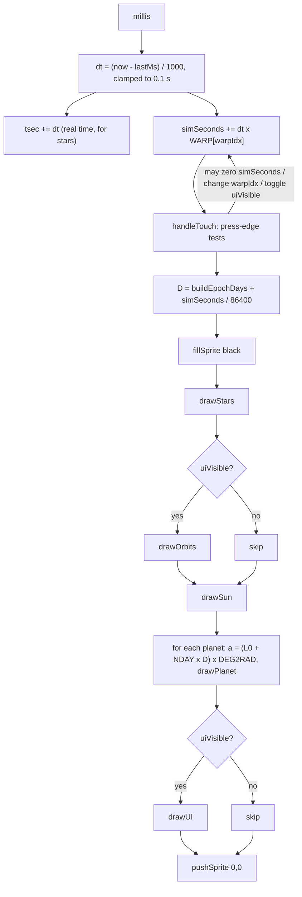
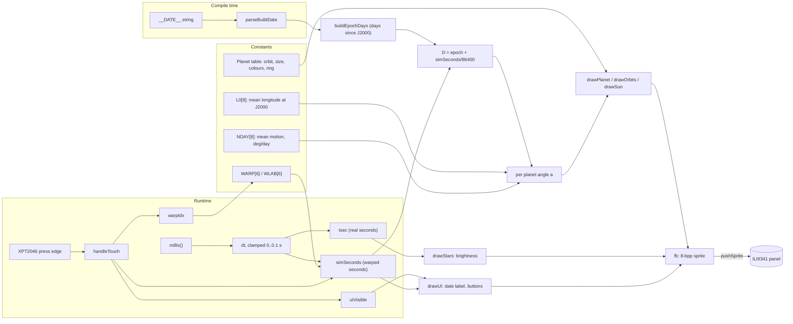

# 01 - Architecture and data flow

## Shape of the program
The whole firmware is one Arduino translation unit, `src/main.cpp` (240 lines). There are no other source files, no headers of its own, and no libraries beyond those in `platformio.ini:12-14`. The program is the usual Arduino pair: `setup()` (`src/main.cpp:172-194`) runs once, and `loop()` (`src/main.cpp:217-240`) runs forever.

Logical sections, in file order:

| Section | Lines | Role |
|---|---|---|
| Hardware objects | `16-28` | `TFT_eSPI tft`, `TFT_eSprite fb`, touch pins, `touchSPI` (VSPI), `ts` |
| Planet table and constants | `30-70` | `Planet` struct, 8 planets, `L0[]`, `NDAY[]`, scale factors |
| Starfield state | `55-57` | 80 stars, arrays of positions, brightness, phase |
| Global state | `59-65` | `uiVisible`, `lastMs`, `tsec`, `simSeconds`, `buildEpochDays`, build date, `wasTouched` |
| Date helpers | `73-91` | `gregToJDN`, `jdnToGreg`, `parseBuildDate` |
| Drawing helpers | `93-134` | colour dimming, stars, orbits, Sun, planets |
| UI geometry and labels | `137-170` | warp table, button positions, `drawBtn`, `drawUI` |
| Touch | `196-215` | `handleTouch` |
| Entry points | `172-194`, `217-240` | `setup`, `loop` |

## Startup sequence (`setup`, `src/main.cpp:172-194`)
1. `Serial.begin(115200)` (`173`), seed the RNG from `esp_random()` (`174`), and parse the build date (`175`, see [02](02-algorithms-timing.md#build-date)).
2. `tft.init()` and `setRotation(1)` (`177-178`). Read the size with `tft.width()` and `tft.height()` and derive `CX`, `CY`, and the button positions (`179-181`).
3. Turn the backlight on (`183`), start the touch bus, and begin the touch controller with rotation 1 (`184-185`).
4. Clear the screen (`187`), set the sprite to 8 bpp, and create it at full screen size (`188-189`). On failure, log one line and continue (see [03](03-interfaces-errors-constraints.md#error-handling)).
5. Print the build date and the epoch offset (`190`), seed the stars (`192`), and set `lastMs` (`193`).

## Per-frame flow (`loop`, `src/main.cpp:217-240`)

Notes on the flow, all from the code:
- `handleTouch()` runs after the clock update and before drawing (`src/main.cpp:225`). A touch therefore takes effect in the same frame it is seen, and the sim clock already includes that frame's `dt`.
- The simulated day `D` is computed once per frame (`src/main.cpp:227`) and used for every planet in that frame.
- Only `pushSprite` writes to the panel (`src/main.cpp:239`). All drawing goes to `fb` (the 8-bpp sprite, `src/main.cpp:17`).

## Data-flow diagram (state and sources)

## Module responsibilities and what is not separated
- There is no separation into modules. Date maths, state, drawing, and touch all live in one file, and all state is global.
- The display stack is `TFT_eSPI` plus `TFT_eSprite`. The firmware uses the sprite as a full-frame back buffer (`src/main.cpp:17`, `188`).
- The touch stack is `XPT2046_Touchscreen` on its own `SPIClass` (`src/main.cpp:27-28`).

## Sibling project
`denki-kurage` in the parent folder is a separate project. `platformio.ini:2` says this project's display config mirrors it. `src/main.cpp` contains no reference to it and no shared code (verified by reading the whole file).
